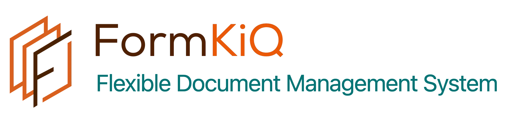
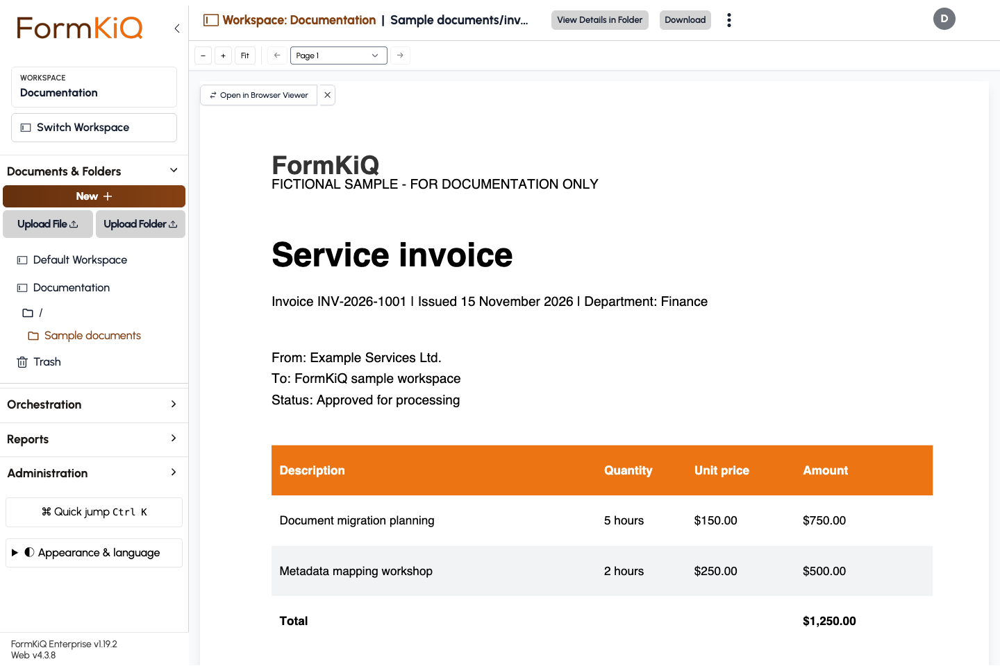
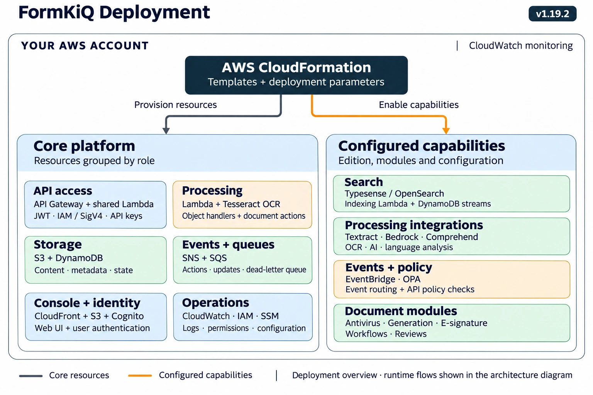
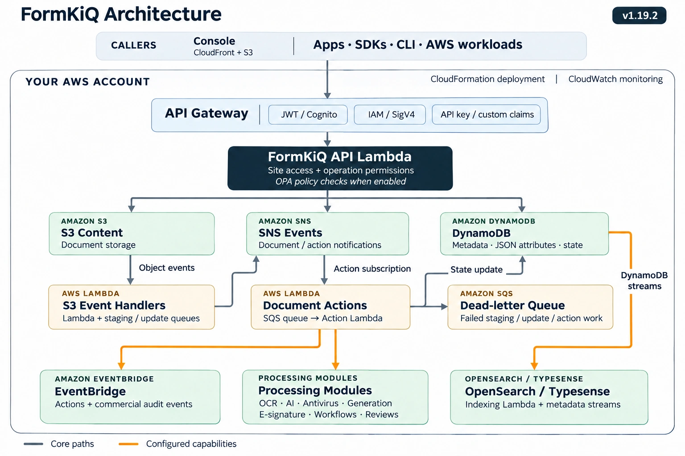

<div align="center">

[Get Started](#quick-start) · [Documentation](https://docs.formkiq.com/) · [API Reference](https://docs.formkiq.com/docs/category/api-reference) · [Compare Editions](https://formkiq.com/pricing) · [Contact Us](mailto:info@formkiq.com)

[](https://github.com/formkiq/formkiq-core)
[](LICENSE)

</div>

# FormKiQ Core

**Open-source document management on AWS. Your document layer, under your control.**

FormKiQ Core gives your applications a dedicated document layer: APIs, storage, metadata, classification, OCR, search, and a Web Console. Deploy it into your own AWS account, integrate it into an existing product, or use the console as a standalone document management system. Run locally with Docker for development and evaluation.

Core is MIT-licensed and free for personal and commercial use. You can use, customize, and distribute it; AWS infrastructure and usage charges apply to cloud deployments.

[Explore FormKiQ Core](https://formkiq.com/platform/formkiq-core) · [Understand the document layer](https://formkiq.com/document-layer)

## Watch FormKiQ Core

[](https://www.youtube.com/watch?v=G5R6ldbHYKs)

[Watch the deployment walkthrough on YouTube](https://www.youtube.com/watch?v=G5R6ldbHYKs), also featured in the [official AWS Quick Start](https://docs.formkiq.com/docs/getting-started/quick-start).

## See the Web Console

[](https://docs.formkiq.com/docs/formkiq-web/working-with-documents)

Screenshot from the [FormKiQ Web Guide](https://docs.formkiq.com/docs/formkiq-web/working-with-documents): Web v4.3.8, Enterprise v1.19.2, with fictional sample data. Available features and navigation vary by edition; Reports and other commercial capabilities shown require a paid edition.

## Who it’s for

- Product and architecture teams adding document management to existing applications.
- SaaS builders organizing documents across teams and tenants.
- Organizations that need control over AWS deployment, data location, and integrations.
- Developers validating a document platform before expanding into workflow automation and governance.

## Capabilities at a glance

- **Store and retrieve:** document APIs, Amazon S3 storage, and bulk uploads.
- **Organize:** metadata, tags, classification, and schemas for validation.
- **Find:** metadata search with DynamoDB and optional basic full-text search with Typesense.
- **Extract:** OCR using Tesseract for scanned content.
- **Extend:** document actions, SNS events, and inbound/outbound webhooks.
- **Serve multiple teams:** multi-team and multi-tenant functionality.
- **Use a Web Console:** upload, browse, search, view, and share documents through a customizable React interface.
- **Integrate:** Cognito JWT, API key, and IAM authentication; Java, Python, and TypeScript SDKs; OpenAPI specifications.

## Why teams choose FormKiQ

- **Keep deployment control:** run in your AWS account and choose the region for your data.
- **Build on an existing foundation:** start with working document APIs, search, and a console.
- **Adapt to your application:** customize the source and connect document events to your systems.
- **Grow on the same platform:** expand into commercial editions as operational and governance needs increase.

## Common use cases

- Embed document storage and retrieval in a SaaS product or internal application.
- Organize invoices, contracts, case files, and correspondence with searchable metadata.
- Make scanned documents discoverable using OCR and full-text indexing.
- Connect uploads and document actions to custom processing and notification services.

## From Core to Enterprise

Core is the open-source foundation of the broader [FormKiQ document and information management platform](https://formkiq.com/platform). Commercial editions add capabilities and support as your requirements grow.

| Edition | Focus |
| --- | --- |
| **Core** | Open-source APIs, console, metadata, search, OCR, and extensibility. |
| **Essentials** | Operational support, SSO, workflows, document control/versioning, and Textract processing. |
| **Advanced** | Available add-on modules for AI processing, document generation, eSignature, enhanced search, and integrations. |
| **Enterprise** | Architecture and governance support, tailored deployment models, and enterprise licensing. |

The wider platform supports contract, case, grants, records, and archives management solutions. See the [current feature and edition comparison](https://formkiq.com/pricing) for availability, add-ons, and support terms.

## Quick Start

1. **Deploy to AWS:** follow the [AWS Quick Start](https://docs.formkiq.com/docs/getting-started/quick-start) for prerequisites and regional CloudFormation launch links. Allow approximately 15–30 minutes for installation.
2. **Run locally:** follow [Run locally with Docker](#run-locally-with-docker) below.
3. **Make your first API call:** follow the [API walkthrough](https://docs.formkiq.com/docs/getting-started/api-walkthrough).

### AWS cost example

Core has no license fee. For an illustration of AWS usage costs, the [AWS Cost Planning guide](https://docs.formkiq.com/docs/platform/costs#illustrative-cost-examples) models adding **1 million documents averaging 1 MB each** (about 1 TB), with basic metadata processing and S3 Standard storage:

| Cost component | Published illustrative cost (USD) |
| --- | --- |
| Ingestion: S3 PUT requests, Lambda requests/execution, and DynamoDB writes | About $27 |
| Storage: about 1 TB in S3 Standard plus 1 GB of DynamoDB metadata | About $30/month |
| Ingestion plus one month of storage | About $57 |

These rounded figures cover the listed components only. API Gateway, downloads/data transfer, console traffic, authentication, messaging, logs, backups, and networking add costs. OCR, full-text search, replication, and extra document versions are excluded; Typesense adds ongoing compute and storage costs even when idle. The example assumes no Free Tier discounts. Recalculate for your AWS region and workload with the [AWS Pricing Calculator](https://calculator.aws/) before deployment.

### Run locally with Docker
The `apps/netty-server` module mimics the AWS API Gateway + Lambda runtime so FormKiQ Core can run as a Docker Compose stack.

Requirements:
- Docker
- Java 25
- Gradle wrapper from this repository

The local stack uses separate S3 endpoints for browser-facing presigned URLs and
container-side document actions. API responses use `S3_PRESIGNER_URL=http://localhost:9000`,
while local action processing uses `API_URL=http://api:8080` and
`S3_ACTIONS_PRESIGNER_URL=http://minio:9000` so containers can reach the API and MinIO
through Docker DNS.

Build the local Docker package:

```bash
./gradlew assembleNettyServer
```

Unpack and start FormKiQ:

```bash
cd build/distributions
unzip formkiq-core-netty-server-*.zip
cd formkiq-core-netty-server-*
docker compose up --build
```

Open:
- Console: <http://localhost>
- API: <http://localhost:8080>
- Keycloak: <http://localhost:8081>
- MinIO: <http://localhost:9000>
- DynamoDB Local: <http://localhost:8000>
- Typesense: <http://localhost:8108>

Default local login:
- Username: `admin@me.com`
- Password: `password`

### Configure Typesense on AWS

For optional full-text search, follow the [Typesense configuration and migration guide](docs/typesense-configuration.md), including Secrets Manager setup and API key rotation.

### Common API flow
1. Log in with `POST /login`.
2. Upload or create a document with `POST /documents`.
3. Read document content or metadata with `GET /documents/{documentId}`.
4. Search, tag, update, or route documents through events as needed.

## Architecture

The AWS foundation uses Lambda, API Gateway, S3, and DynamoDB, with Cognito for user authentication and CloudFront for the Web Console. Optional Typesense provides basic full-text search; Tesseract provides OCR. Document events and webhooks connect Core to downstream services. Typesense uses provisioned compute alongside the serverless API and storage services.

These v1.19.2 diagrams show the broader FormKiQ platform. Orange connectors identify configured capabilities whose availability depends on edition, installed modules, and configuration. Select either diagram to view it at full size.

### Deployment

[](docs/images/formkiq-deployment-technical-light-v1.19.2.webp)

Source: [Deployment overview](https://docs.formkiq.com/docs/overview#deployment). The connections show provisioning and configuration relationships.

### Platform architecture

[](docs/images/formkiq-architecture-technical-light-v1.19.2.webp)

Source: [Platform Overview](https://docs.formkiq.com/docs/platform/overview), including request flows, component descriptions, and diagram sources.

## Project structure & commands
- `apps/`: Lambda apps, console, and the local Netty server.
- `domain/`: document, event, action, OCR, and plugin domain modules.
- `adapters/aws/`: AWS service adapters.
- `libs/`: shared libraries.
- `packaging/`: AWS Cloud, CloudFormation, and OpenAPI packaging.
- Templates/assets: `src/main/resources/cloudformation`, `docs/`, `images/`, `docker/`.

Common commands:

```bash
./gradlew assembleAwsCloud       # Build the AWS distribution ZIP
./gradlew assembleNettyServer    # Build the local Docker distribution ZIP
./gradlew integrationtests       # Run Docker-based Netty integration tests
./gradlew test                   # Run unit tests
./gradlew spotlessCheck          # Verify formatting
./gradlew licenseReport          # Regenerate license inventory
```

## Client SDKs
- **[Java SDK](https://github.com/formkiq/formkiq-client-sdk-java)** — best for JVM backends.
- **[Python SDK](https://github.com/formkiq/formkiq-client-sdk-python)** — scripting/data workflows.
- **[TypeScript SDK](https://github.com/formkiq/formkiq-client-sdk-typescript)** — web and Node.js apps.
- Other languages via [OpenAPI Generator](https://github.com/OpenAPITools/openapi-generator) using the published spec.

## Client Tutorials
- **[Python SDK Tutorial](https://docs.formkiq.com/docs/tutorials/using-python-client-sdk)** — Python SDK Document API walkthrough
- **[TypeScript SDK Tutorial](https://docs.formkiq.com/docs/tutorials/using-typescript-client-sdk)** — TypeScript SDK Document API walkthrough

## Resources & support
- Docs: [Complete Documentation](https://docs.formkiq.com), [API Reference](https://docs.formkiq.com/docs/category/api-reference), [Tutorials](https://docs.formkiq.com/docs/category/tutorials), [How-To Guides](https://docs.formkiq.com/docs/category/how-to)
- Updates: [Blog](https://blog.formkiq.com)
- Issues/questions: [GitHub Issues](https://github.com/formkiq/formkiq-core/issues)
- Enterprise inquiries: [Contact](mailto:info@formkiq.com) or [formkiq.com](https://www.formkiq.com/pricing)

## License

FormKiQ Core is available under the [MIT License](LICENSE).
